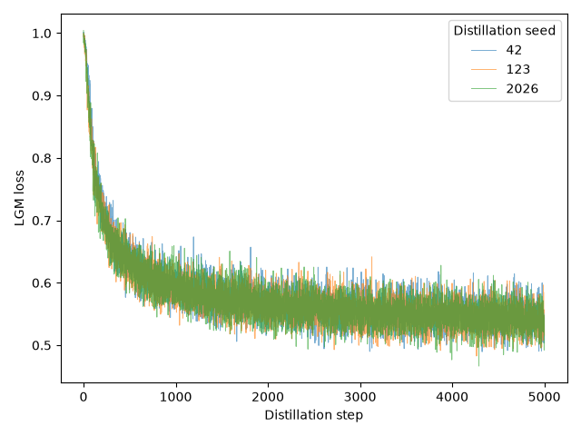
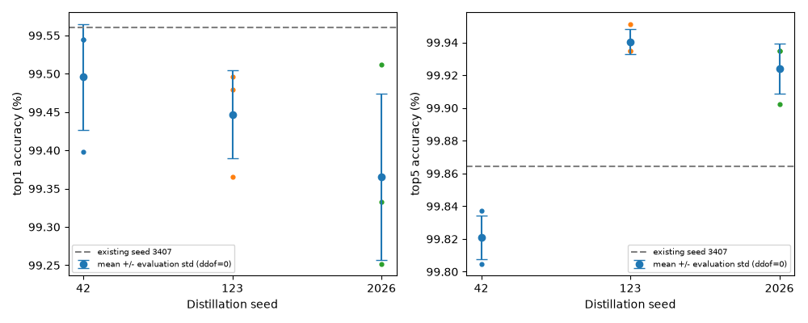
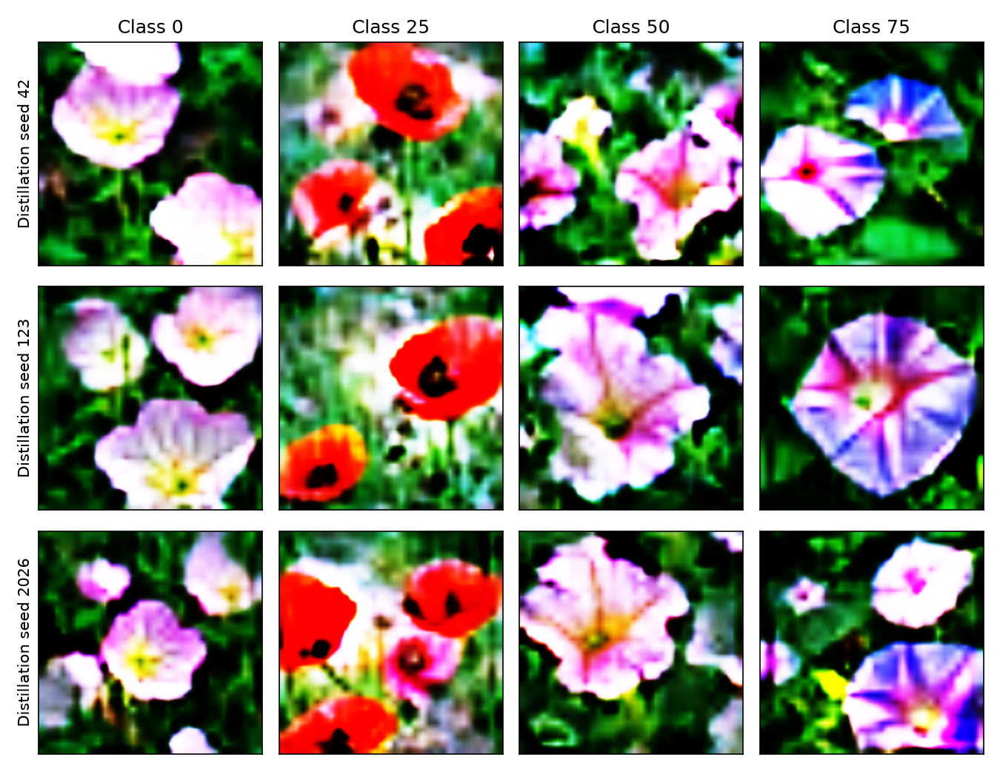

# Generator方式：蒸留シードの再現性実験

更新（UTC）: 2026-10-15T00:38:16.034975+00:00

状態: **complete**。ユーザー承認に基づき最大6本を直列実行。失敗時の再投入は行わない。

flowers102 / dinov2_vitb / generator_pixel / Adam / lr=0.002 / IPC=1 / iterations=5000（5,001更新）。
蒸留seed=42・123・2026。各結果を公式`distillation.eval`で3回評価（seed=3407・3408・3409、eval_epochs=1000）。
H100×1、gpu_1=1、優先度0、tga-lab_otm、W&B offline。蒸留2時間・評価1時間、全6本の最大1.44ポイント。
損失・Adam・Generator構造・公式評価は既存seed3407と同一。学習対象はGeneratorのみで固定ノイズを更新しない。

## 実行記録

| 蒸留seed | 処理 | Job ID | 終了コード / failed | 処理秒 | 会計秒 | GPU peak allocated GiB | 検証 |
|---:|---|---|---|---:|---:|---:|---|
| 42 | distill | 9011716 | 0 / 0 | 1499.867 | 1663.883 | 15.652 | passed |
| 42 | eval | 9011850 | 0 / 0 | 404.888 | 435.829 | 2.046 | passed |
| 123 | distill | 9011891 | 0 / 0 | 1911.903 | 2087.618 | 15.652 | passed |
| 123 | eval | 9012260 | 0 / 0 | 412.352 | 439.041 | 2.046 | passed |
| 2026 | distill | 9012295 | 0 / 0 | 1338.178 | 1372.006 | 15.652 | passed |
| 2026 | eval | 9012395 | 0 / 0 | 446.711 | 478.410 | 2.046 | passed |

取得済みqacctからの計算ポイント推定合計: **0.4316**（会計確定値ではなく公式式による推定、ストレージを除く）。
GPUメモリはPyTorch max_memory_allocated。処理秒とスケジューラ会計秒は測定範囲が異なる。

## 精度とばらつき

# Generator蒸留シードの再現性比較

GPUジョブはユーザー承認後にのみ投入する。未取得の値は未実施とする。

| 蒸留seed | Top-1（評価3回）| Top-1 平均±評価std | Top-5（評価3回）| Top-5 平均±評価std | 蒸留秒 | GPU GiB |
|---:|---|---|---|---|---:|---:|
| 42 | 99.5446%, 99.5446%, 99.3983% | 99.4959% ± 0.0690 pt | 99.8211%, 99.8048%, 99.8374% | 99.8211% ± 0.0133 pt | 1499.866647590883 | 15.652087688446045 |
| 123 | 99.3658%, 99.4959%, 99.4796% | 99.4471% ± 0.0579 pt | 99.9349%, 99.9512%, 99.9349% | 99.9404% ± 0.0077 pt | 1911.9031624952331 | 15.652087688446045 |
| 2026 | 99.2519%, 99.5121%, 99.3332% | 99.3658% ± 0.1087 pt | 99.9349%, 99.9024%, 99.9349% | 99.9241% ± 0.0153 pt | 1338.1782441479154 | 15.652087688446045 |

評価内stdは各蒸留結果に対する3回の評価の母標準偏差（ddof=0）。
蒸留seed間stdは42・123・2026の各評価平均を3点として計算する。9回の評価を独立な蒸留9回として数えない。
既存3407を含む4点の集計は副次解析として別記する。

## シード間集計

| 集計対象 | Top-1平均 | 蒸留seed間Top-1 std | Top-5平均 | 蒸留seed間Top-5 std |
|---|---:|---:|---:|---:|
| 新規42/123/2026（主解析） | 99.4362% | 0.0537 pt | 99.8952% | 0.0528 pt |
| 既存3407を含む4点（副次解析） | 99.4674% | 0.0712 pt | 99.8875% | 0.0476 pt |

## 各実験のファイル

- seed 42: `seed_42/distill/loss.csv`、`loss_curve.png`、`images/`、`generator_final.pth`、`checkpoints/`、`seed_42/eval/eval_status.json`。
- seed 123: `seed_123/distill/loss.csv`、`loss_curve.png`、`images/`、`generator_final.pth`、`checkpoints/`、`seed_123/eval/eval_status.json`。
- seed 2026: `seed_2026/distill/loss.csv`、`loss_curve.png`、`images/`、`generator_final.pth`、`checkpoints/`、`seed_2026/eval/eval_status.json`。





## 蒸留Loss・保存内容

| 蒸留seed | 更新数 | 初回Loss | 最終Loss | 最小Loss | PNG数 | Generator更新 / ノイズ固定 |
|---:|---:|---:|---:|---:|---:|---|
| 42 | 5001 | 0.999955 | 0.543718 | 0.489525 | 102 | True / True |
| 123 | 5001 | 0.994202 | 0.515994 | 0.482594 | 102 | True / True |
| 2026 | 5001 | 1.004365 | 0.513701 | 0.466526 | 102 | True / True |

### 蒸留seed 42

最終data.pth: `/gs/bs/tga-lab_otm/us07824-lgm-generator-seeds-wrpWhzXU/seed_42/distill/distillation/flowers102/dinov2_vitb/flowers102_generator_pixel_adam_it5000_ipc1_seed42/data.pth`。SHA256: `ba1ed540029844b879f7b7c6699c74a2c64c8588c900f076d0fef2025a1069bb`。

重み・固定ノイズ・ラベル・Adam: `seed_42/distill/generator_final.pth`。最終checkpoint: `seed_42/distill/checkpoints/step_05000_final.pth`。
初期化記録: `seed_42/distill/initialization.json`。途中checkpoint: `seed_42/distill/checkpoints/step_*.pth`。
全Loss: `seed_42/distill/loss.csv`。PNG一覧: `seed_42/distill/images/class_000.png`〜`class_101.png`。
評価: `seed_42/eval/eval_status.json`・`evaluation-validation.json`・`evaluation-checkpoints/`。


### 蒸留seed 123

最終data.pth: `/gs/bs/tga-lab_otm/us07824-lgm-generator-seeds-wrpWhzXU/seed_123/distill/distillation/flowers102/dinov2_vitb/flowers102_generator_pixel_adam_it5000_ipc1_seed123/data.pth`。SHA256: `f3dfe864f00636db49927cee738fe32e25d692360130dddfcf5e7d33b8a36a6f`。

重み・固定ノイズ・ラベル・Adam: `seed_123/distill/generator_final.pth`。最終checkpoint: `seed_123/distill/checkpoints/step_05000_final.pth`。
初期化記録: `seed_123/distill/initialization.json`。途中checkpoint: `seed_123/distill/checkpoints/step_*.pth`。
全Loss: `seed_123/distill/loss.csv`。PNG一覧: `seed_123/distill/images/class_000.png`〜`class_101.png`。
評価: `seed_123/eval/eval_status.json`・`evaluation-validation.json`・`evaluation-checkpoints/`。


### 蒸留seed 2026

最終data.pth: `/gs/bs/tga-lab_otm/us07824-lgm-generator-seeds-wrpWhzXU/seed_2026/distill/distillation/flowers102/dinov2_vitb/flowers102_generator_pixel_adam_it5000_ipc1_seed2026/data.pth`。SHA256: `1eef2ef52c877f97ee62b27c83dfe8b1d769456e9e7d5e7983cabf9949b2bfe6`。

重み・固定ノイズ・ラベル・Adam: `seed_2026/distill/generator_final.pth`。最終checkpoint: `seed_2026/distill/checkpoints/step_05000_final.pth`。
初期化記録: `seed_2026/distill/initialization.json`。途中checkpoint: `seed_2026/distill/checkpoints/step_*.pth`。
全Loss: `seed_2026/distill/loss.csv`。PNG一覧: `seed_2026/distill/images/class_000.png`〜`class_101.png`。
評価: `seed_2026/eval/eval_status.json`・`evaluation-validation.json`・`evaluation-checkpoints/`。


同じクラス（0・25・50・75）を蒸留seed間で比較:



9回の実測精度をCSVでも保存: [accuracies.csv](accuracies.csv)。

## 検証・エラーと警告

蒸留正常終了・5001更新・Adam step・Generator更新・固定ノイズ不変・data形状[102,3,256,256]・float32値域[0,1]・ラベルint64 0〜101・PNG102枚・checkpoint11個を独立CPU検証する。
評価は保存済みdata.pthを読み取り専用コピーして使用。CPUでGeneratorを再生成した画像は評価に使用しない。
各評価で新しい分類器と空のAdam状態を検証し、評価前後の入力ハッシュを照合する。

`seed_123/distill/logs/distill.log`:
```text
/gs/bs/tga-lab_otm/us07824-lgm-pixel-rEKz7ETv/env/lib/python3.11/site-packages/outdated/__init__.py:36: UserWarning: pkg_resources is deprecated as an API. See https://setuptools.pypa.io/en/latest/pkg_resources.html. The pkg_resources package is slated for removal as early as 2025-11-30. Refrain from using this package or pin to Setuptools<81.
/gs/bs/tga-lab_otm/us07824-lgm-pixel-rEKz7ETv/env/lib/python3.11/site-packages/timm/models/layers/__init__.py:49: FutureWarning: Importing from timm.models.layers is deprecated, please import via timm.layers
wandb: WARNING `resume` will be ignored since W&B syncing is set to `offline`. Starting a new run with run id flowers102_generator_pixel_adam_it5000_ipc1_seed123.
/gs/bs/tga-lab_otm/us07824-lgm-pixel-rEKz7ETv/cache/torch/hub/facebookresearch_dinov2_main/dinov2/layers/swiglu_ffn.py:45: UserWarning: xFormers is disabled (SwiGLU)
/gs/bs/tga-lab_otm/us07824-lgm-pixel-rEKz7ETv/cache/torch/hub/facebookresearch_dinov2_main/dinov2/layers/swiglu_ffn.py:51: UserWarning: xFormers is not available (SwiGLU)
/gs/bs/tga-lab_otm/us07824-lgm-pixel-rEKz7ETv/cache/torch/hub/facebookresearch_dinov2_main/dinov2/layers/attention.py:29: UserWarning: xFormers is disabled (Attention)
/gs/bs/tga-lab_otm/us07824-lgm-pixel-rEKz7ETv/cache/torch/hub/facebookresearch_dinov2_main/dinov2/layers/attention.py:33: UserWarning: xFormers is not available (Attention)
/gs/bs/tga-lab_otm/us07824-lgm-pixel-rEKz7ETv/cache/torch/hub/facebookresearch_dinov2_main/dinov2/layers/block.py:35: UserWarning: xFormers is disabled (Block)
/gs/bs/tga-lab_otm/us07824-lgm-pixel-rEKz7ETv/cache/torch/hub/facebookresearch_dinov2_main/dinov2/layers/block.py:40: UserWarning: xFormers is not available (Block)
Distilling Images:   0%|          | 0/5001 [00:00<?, ?it/s]/gs/bs/tga-lab_otm/us07824-lgm-generator-seeds-wrpWhzXU/seed_123/distill/src/distillation/linear_gm.py:199: FutureWarning: `torch.cuda.amp.autocast(args...)` is deprecated. Please use `torch.amp.autocast('cuda', args...)` instead.
/gs/bs/tga-lab_otm/us07824-lgm-generator-seeds-wrpWhzXU/seed_123/distill/src/distillation/linear_gm.py:237: FutureWarning: `torch.cuda.amp.autocast(args...)` is deprecated. Please use `torch.amp.autocast('cuda', args...)` instead.
```
`seed_123/distill/logs/independent-validation.log`:
```text
/gs/bs/tga-lab_otm/us07824-lgm-pixel-rEKz7ETv/env/lib/python3.11/site-packages/outdated/__init__.py:36: UserWarning: pkg_resources is deprecated as an API. See https://setuptools.pypa.io/en/latest/pkg_resources.html. The pkg_resources package is slated for removal as early as 2025-11-30. Refrain from using this package or pin to Setuptools<81.
```
`seed_123/eval/logs/eval.log`:
```text
/gs/bs/tga-lab_otm/us07824-lgm-pixel-rEKz7ETv/env/lib/python3.11/site-packages/outdated/__init__.py:36: UserWarning: pkg_resources is deprecated as an API. See https://setuptools.pypa.io/en/latest/pkg_resources.html. The pkg_resources package is slated for removal as early as 2025-11-30. Refrain from using this package or pin to Setuptools<81.
/gs/bs/tga-lab_otm/us07824-lgm-pixel-rEKz7ETv/env/lib/python3.11/site-packages/timm/models/layers/__init__.py:49: FutureWarning: Importing from timm.models.layers is deprecated, please import via timm.layers
/gs/bs/tga-lab_otm/us07824-lgm-pixel-rEKz7ETv/cache/torch/hub/facebookresearch_dinov2_main/dinov2/layers/swiglu_ffn.py:45: UserWarning: xFormers is disabled (SwiGLU)
/gs/bs/tga-lab_otm/us07824-lgm-pixel-rEKz7ETv/cache/torch/hub/facebookresearch_dinov2_main/dinov2/layers/swiglu_ffn.py:51: UserWarning: xFormers is not available (SwiGLU)
/gs/bs/tga-lab_otm/us07824-lgm-pixel-rEKz7ETv/cache/torch/hub/facebookresearch_dinov2_main/dinov2/layers/attention.py:29: UserWarning: xFormers is disabled (Attention)
/gs/bs/tga-lab_otm/us07824-lgm-pixel-rEKz7ETv/cache/torch/hub/facebookresearch_dinov2_main/dinov2/layers/attention.py:33: UserWarning: xFormers is not available (Attention)
/gs/bs/tga-lab_otm/us07824-lgm-pixel-rEKz7ETv/cache/torch/hub/facebookresearch_dinov2_main/dinov2/layers/block.py:35: UserWarning: xFormers is disabled (Block)
/gs/bs/tga-lab_otm/us07824-lgm-pixel-rEKz7ETv/cache/torch/hub/facebookresearch_dinov2_main/dinov2/layers/block.py:40: UserWarning: xFormers is not available (Block)
/gs/bs/tga-lab_otm/us07824-lgm-generator-seeds-wrpWhzXU/seed_123/eval/src/distillation/eval.py:98: FutureWarning: `torch.cuda.amp.GradScaler(args...)` is deprecated. Please use `torch.amp.GradScaler('cuda', args...)` instead.
Epoch Progress:   0%|          | 0/2 [00:00<?, ?it/s]/gs/bs/tga-lab_otm/us07824-lgm-generator-seeds-wrpWhzXU/seed_123/eval/src/distillation/eval.py:148: FutureWarning: `torch.cuda.amp.autocast(args...)` is deprecated. Please use `torch.amp.autocast('cuda', args...)` instead.
```
`seed_2026/distill/logs/distill.log`:
```text
/gs/bs/tga-lab_otm/us07824-lgm-pixel-rEKz7ETv/env/lib/python3.11/site-packages/outdated/__init__.py:36: UserWarning: pkg_resources is deprecated as an API. See https://setuptools.pypa.io/en/latest/pkg_resources.html. The pkg_resources package is slated for removal as early as 2025-11-30. Refrain from using this package or pin to Setuptools<81.
/gs/bs/tga-lab_otm/us07824-lgm-pixel-rEKz7ETv/env/lib/python3.11/site-packages/timm/models/layers/__init__.py:49: FutureWarning: Importing from timm.models.layers is deprecated, please import via timm.layers
wandb: WARNING `resume` will be ignored since W&B syncing is set to `offline`. Starting a new run with run id flowers102_generator_pixel_adam_it5000_ipc1_seed2026.
/gs/bs/tga-lab_otm/us07824-lgm-pixel-rEKz7ETv/cache/torch/hub/facebookresearch_dinov2_main/dinov2/layers/swiglu_ffn.py:45: UserWarning: xFormers is disabled (SwiGLU)
/gs/bs/tga-lab_otm/us07824-lgm-pixel-rEKz7ETv/cache/torch/hub/facebookresearch_dinov2_main/dinov2/layers/swiglu_ffn.py:51: UserWarning: xFormers is not available (SwiGLU)
/gs/bs/tga-lab_otm/us07824-lgm-pixel-rEKz7ETv/cache/torch/hub/facebookresearch_dinov2_main/dinov2/layers/attention.py:29: UserWarning: xFormers is disabled (Attention)
/gs/bs/tga-lab_otm/us07824-lgm-pixel-rEKz7ETv/cache/torch/hub/facebookresearch_dinov2_main/dinov2/layers/attention.py:33: UserWarning: xFormers is not available (Attention)
/gs/bs/tga-lab_otm/us07824-lgm-pixel-rEKz7ETv/cache/torch/hub/facebookresearch_dinov2_main/dinov2/layers/block.py:35: UserWarning: xFormers is disabled (Block)
/gs/bs/tga-lab_otm/us07824-lgm-pixel-rEKz7ETv/cache/torch/hub/facebookresearch_dinov2_main/dinov2/layers/block.py:40: UserWarning: xFormers is not available (Block)
Distilling Images:   0%|          | 0/5001 [00:00<?, ?it/s]/gs/bs/tga-lab_otm/us07824-lgm-generator-seeds-wrpWhzXU/seed_2026/distill/src/distillation/linear_gm.py:199: FutureWarning: `torch.cuda.amp.autocast(args...)` is deprecated. Please use `torch.amp.autocast('cuda', args...)` instead.
/gs/bs/tga-lab_otm/us07824-lgm-generator-seeds-wrpWhzXU/seed_2026/distill/src/distillation/linear_gm.py:237: FutureWarning: `torch.cuda.amp.autocast(args...)` is deprecated. Please use `torch.amp.autocast('cuda', args...)` instead.
```
`seed_2026/distill/logs/independent-validation.log`:
```text
/gs/bs/tga-lab_otm/us07824-lgm-pixel-rEKz7ETv/env/lib/python3.11/site-packages/outdated/__init__.py:36: UserWarning: pkg_resources is deprecated as an API. See https://setuptools.pypa.io/en/latest/pkg_resources.html. The pkg_resources package is slated for removal as early as 2025-11-30. Refrain from using this package or pin to Setuptools<81.
```
`seed_2026/eval/logs/eval.log`:
```text
/gs/bs/tga-lab_otm/us07824-lgm-pixel-rEKz7ETv/env/lib/python3.11/site-packages/outdated/__init__.py:36: UserWarning: pkg_resources is deprecated as an API. See https://setuptools.pypa.io/en/latest/pkg_resources.html. The pkg_resources package is slated for removal as early as 2025-11-30. Refrain from using this package or pin to Setuptools<81.
/gs/bs/tga-lab_otm/us07824-lgm-pixel-rEKz7ETv/env/lib/python3.11/site-packages/timm/models/layers/__init__.py:49: FutureWarning: Importing from timm.models.layers is deprecated, please import via timm.layers
/gs/bs/tga-lab_otm/us07824-lgm-pixel-rEKz7ETv/cache/torch/hub/facebookresearch_dinov2_main/dinov2/layers/swiglu_ffn.py:45: UserWarning: xFormers is disabled (SwiGLU)
/gs/bs/tga-lab_otm/us07824-lgm-pixel-rEKz7ETv/cache/torch/hub/facebookresearch_dinov2_main/dinov2/layers/swiglu_ffn.py:51: UserWarning: xFormers is not available (SwiGLU)
/gs/bs/tga-lab_otm/us07824-lgm-pixel-rEKz7ETv/cache/torch/hub/facebookresearch_dinov2_main/dinov2/layers/attention.py:29: UserWarning: xFormers is disabled (Attention)
/gs/bs/tga-lab_otm/us07824-lgm-pixel-rEKz7ETv/cache/torch/hub/facebookresearch_dinov2_main/dinov2/layers/attention.py:33: UserWarning: xFormers is not available (Attention)
/gs/bs/tga-lab_otm/us07824-lgm-pixel-rEKz7ETv/cache/torch/hub/facebookresearch_dinov2_main/dinov2/layers/block.py:35: UserWarning: xFormers is disabled (Block)
/gs/bs/tga-lab_otm/us07824-lgm-pixel-rEKz7ETv/cache/torch/hub/facebookresearch_dinov2_main/dinov2/layers/block.py:40: UserWarning: xFormers is not available (Block)
/gs/bs/tga-lab_otm/us07824-lgm-generator-seeds-wrpWhzXU/seed_2026/eval/src/distillation/eval.py:98: FutureWarning: `torch.cuda.amp.GradScaler(args...)` is deprecated. Please use `torch.amp.GradScaler('cuda', args...)` instead.
Epoch Progress:   0%|          | 0/2 [00:00<?, ?it/s]/gs/bs/tga-lab_otm/us07824-lgm-generator-seeds-wrpWhzXU/seed_2026/eval/src/distillation/eval.py:148: FutureWarning: `torch.cuda.amp.autocast(args...)` is deprecated. Please use `torch.amp.autocast('cuda', args...)` instead.
```
`seed_42/distill/logs/distill.log`:
```text
/gs/bs/tga-lab_otm/us07824-lgm-pixel-rEKz7ETv/env/lib/python3.11/site-packages/outdated/__init__.py:36: UserWarning: pkg_resources is deprecated as an API. See https://setuptools.pypa.io/en/latest/pkg_resources.html. The pkg_resources package is slated for removal as early as 2025-11-30. Refrain from using this package or pin to Setuptools<81.
/gs/bs/tga-lab_otm/us07824-lgm-pixel-rEKz7ETv/env/lib/python3.11/site-packages/timm/models/layers/__init__.py:49: FutureWarning: Importing from timm.models.layers is deprecated, please import via timm.layers
wandb: WARNING `resume` will be ignored since W&B syncing is set to `offline`. Starting a new run with run id flowers102_generator_pixel_adam_it5000_ipc1_seed42.
/gs/bs/tga-lab_otm/us07824-lgm-pixel-rEKz7ETv/cache/torch/hub/facebookresearch_dinov2_main/dinov2/layers/swiglu_ffn.py:45: UserWarning: xFormers is disabled (SwiGLU)
/gs/bs/tga-lab_otm/us07824-lgm-pixel-rEKz7ETv/cache/torch/hub/facebookresearch_dinov2_main/dinov2/layers/swiglu_ffn.py:51: UserWarning: xFormers is not available (SwiGLU)
/gs/bs/tga-lab_otm/us07824-lgm-pixel-rEKz7ETv/cache/torch/hub/facebookresearch_dinov2_main/dinov2/layers/attention.py:29: UserWarning: xFormers is disabled (Attention)
/gs/bs/tga-lab_otm/us07824-lgm-pixel-rEKz7ETv/cache/torch/hub/facebookresearch_dinov2_main/dinov2/layers/attention.py:33: UserWarning: xFormers is not available (Attention)
/gs/bs/tga-lab_otm/us07824-lgm-pixel-rEKz7ETv/cache/torch/hub/facebookresearch_dinov2_main/dinov2/layers/block.py:35: UserWarning: xFormers is disabled (Block)
/gs/bs/tga-lab_otm/us07824-lgm-pixel-rEKz7ETv/cache/torch/hub/facebookresearch_dinov2_main/dinov2/layers/block.py:40: UserWarning: xFormers is not available (Block)
Distilling Images:   0%|          | 0/5001 [00:00<?, ?it/s]/gs/bs/tga-lab_otm/us07824-lgm-generator-seeds-wrpWhzXU/seed_42/distill/src/distillation/linear_gm.py:199: FutureWarning: `torch.cuda.amp.autocast(args...)` is deprecated. Please use `torch.amp.autocast('cuda', args...)` instead.
/gs/bs/tga-lab_otm/us07824-lgm-generator-seeds-wrpWhzXU/seed_42/distill/src/distillation/linear_gm.py:237: FutureWarning: `torch.cuda.amp.autocast(args...)` is deprecated. Please use `torch.amp.autocast('cuda', args...)` instead.
```
`seed_42/distill/logs/independent-validation.log`:
```text
/gs/bs/tga-lab_otm/us07824-lgm-pixel-rEKz7ETv/env/lib/python3.11/site-packages/outdated/__init__.py:36: UserWarning: pkg_resources is deprecated as an API. See https://setuptools.pypa.io/en/latest/pkg_resources.html. The pkg_resources package is slated for removal as early as 2025-11-30. Refrain from using this package or pin to Setuptools<81.
```
`seed_42/eval/logs/eval.log`:
```text
/gs/bs/tga-lab_otm/us07824-lgm-pixel-rEKz7ETv/env/lib/python3.11/site-packages/outdated/__init__.py:36: UserWarning: pkg_resources is deprecated as an API. See https://setuptools.pypa.io/en/latest/pkg_resources.html. The pkg_resources package is slated for removal as early as 2025-11-30. Refrain from using this package or pin to Setuptools<81.
/gs/bs/tga-lab_otm/us07824-lgm-pixel-rEKz7ETv/env/lib/python3.11/site-packages/timm/models/layers/__init__.py:49: FutureWarning: Importing from timm.models.layers is deprecated, please import via timm.layers
/gs/bs/tga-lab_otm/us07824-lgm-pixel-rEKz7ETv/cache/torch/hub/facebookresearch_dinov2_main/dinov2/layers/swiglu_ffn.py:45: UserWarning: xFormers is disabled (SwiGLU)
/gs/bs/tga-lab_otm/us07824-lgm-pixel-rEKz7ETv/cache/torch/hub/facebookresearch_dinov2_main/dinov2/layers/swiglu_ffn.py:51: UserWarning: xFormers is not available (SwiGLU)
/gs/bs/tga-lab_otm/us07824-lgm-pixel-rEKz7ETv/cache/torch/hub/facebookresearch_dinov2_main/dinov2/layers/attention.py:29: UserWarning: xFormers is disabled (Attention)
/gs/bs/tga-lab_otm/us07824-lgm-pixel-rEKz7ETv/cache/torch/hub/facebookresearch_dinov2_main/dinov2/layers/attention.py:33: UserWarning: xFormers is not available (Attention)
/gs/bs/tga-lab_otm/us07824-lgm-pixel-rEKz7ETv/cache/torch/hub/facebookresearch_dinov2_main/dinov2/layers/block.py:35: UserWarning: xFormers is disabled (Block)
/gs/bs/tga-lab_otm/us07824-lgm-pixel-rEKz7ETv/cache/torch/hub/facebookresearch_dinov2_main/dinov2/layers/block.py:40: UserWarning: xFormers is not available (Block)
/gs/bs/tga-lab_otm/us07824-lgm-generator-seeds-wrpWhzXU/seed_42/eval/src/distillation/eval.py:98: FutureWarning: `torch.cuda.amp.GradScaler(args...)` is deprecated. Please use `torch.amp.GradScaler('cuda', args...)` instead.
Epoch Progress:   0%|          | 0/2 [00:00<?, ?it/s]/gs/bs/tga-lab_otm/us07824-lgm-generator-seeds-wrpWhzXU/seed_42/eval/src/distillation/eval.py:148: FutureWarning: `torch.cuda.amp.autocast(args...)` is deprecated. Please use `torch.amp.autocast('cuda', args...)` instead.
```

以前のPixel/Generator実験の保護対象17ファイルはすべてSHA256一致。

既存Generator seed3407: Top-1平均99.5609045%、Top-5平均99.8644749%。Pixel Top-1平均97.1431673%。
評価内stdは同じ合成画像に対する分類器初期化のばらつき、蒸留seed間stdは合成画像を学習し直すことによる評価平均のばらつき。いずれもddof=0。
3シードの結果はこの条件下の再現性を調べるものであり、全初期化や他モデルでの一致を保証しない。

承認済み計画とCPU検証: [preparation_report.md](preparation_report.md)、`study-plan.json`、`seed-validation.json`、`execution-plan-validation.json`。
実行記録: `execution-status.json`。未完了の実測値は未実施とし推定で補完しない。
