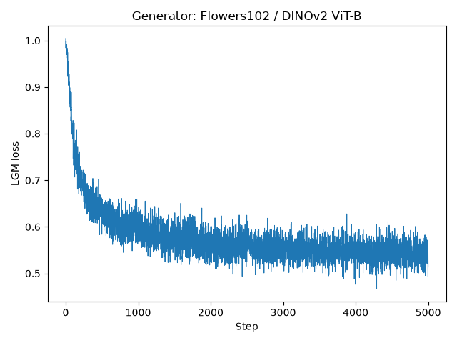

# Generator seed 2026: distill

状態: success

```json
{
  "status": "success",
  "job_id": "9012295",
  "completed_updates": 5001,
  "gpu": "NVIDIA H100",
  "torch": "2.8.0+cu126",
  "cuda": "12.6",
  "distillation_seed": 2026,
  "config": {
    "pyramid_start_res": 1,
    "decorrelate_color": true,
    "distill_mode": "generator_pixel",
    "iterations": 5000,
    "syn_res": 256,
    "skip_if_exists": false,
    "aug_mode": "standard",
    "distill_opt": "adam",
    "train_crop_mode": "random",
    "device_count": 1,
    "lr": 0.002,
    "model": "dinov2_vitb",
    "run_name": "flowers102_generator_pixel_adam_it5000_ipc1_seed2026",
    "generator_latent_dim": 128,
    "crop_res": 224,
    "dataset": "flowers102",
    "augs_per_batch": 1,
    "image_log_it": 500,
    "init_mode": "noise",
    "real_res": 256,
    "job_tag": "/gs/bs/tga-lab_otm/us07824-lgm-generator-seeds-wrpWhzXU/seed_2026/distill/distillation",
    "checkpoint_it": 100,
    "data_root": "/gs/bs/tga-lab_otm/us07824-lgm-pixel-rEKz7ETv/data",
    "pyramid_extent_it": 200,
    "num_workers": 2,
    "ipc": 1
  },
  "generator_init_cpu_seed": 2026,
  "fixed_noise_init_cuda_seed": 2026,
  "cpu_rng_before_generator_sha256": "879259f7778ee41f7c457ed0a87d3d37dfacb8760fcf0701851f507673c99f1a",
  "cuda_rng_before_noise_sha256": "a8f02cd10262012d33a1c2be90b4ab03bbf252d62bb11f5371301bcfccc7b1a7",
  "initial_noise_sha256": "4a84c9e36558caa6ba01f5899d78355b10907b611e51dfa6f2d31ed3804d8a96",
  "initial_generator_sha256": "90481c09f4ee38266fa865f65d964791caaec15a0fb209b613a75c2f468ed105",
  "dataset_class": "GeneratorDataset",
  "generator_parameters": 1149891,
  "last_step": 5000,
  "last_loss": 0.5137008428573608,
  "elapsed_seconds": 1337.7387861488387,
  "first_loss": 1.0043647289276123,
  "peak_allocated_bytes": 16806301184,
  "fixed_noise_unchanged": true,
  "final_noise_sha256": "4a84c9e36558caa6ba01f5899d78355b10907b611e51dfa6f2d31ed3804d8a96",
  "final_generator_sha256": "76ac9f0fb876e06cba4e51c792609017cf5c756ac483dfe20094b9549f3ad595",
  "generator_parameters_updated": true,
  "adam_steps": 5001,
  "final_images_match_generator": true,
  "experiment_seconds": 1338.1782441479154,
  "checkpoint_restored_on_cpu": true,
  "data_path": "/gs/bs/tga-lab_otm/us07824-lgm-generator-seeds-wrpWhzXU/seed_2026/distill/distillation/flowers102/dinov2_vitb/flowers102_generator_pixel_adam_it5000_ipc1_seed2026/data.pth",
  "data_sha256": "1eef2ef52c877f97ee62b27c83dfe8b1d769456e9e7d5e7983cabf9949b2bfe6",
  "shape": [
    102,
    3,
    256,
    256
  ],
  "png_count": 102,
  "total_seconds": 1352.4699113308452,
  "peak_reserved_bytes": 17301504000
}
```

実験設定: `experiment/plan.json`。既存の実験を上書きしない。



