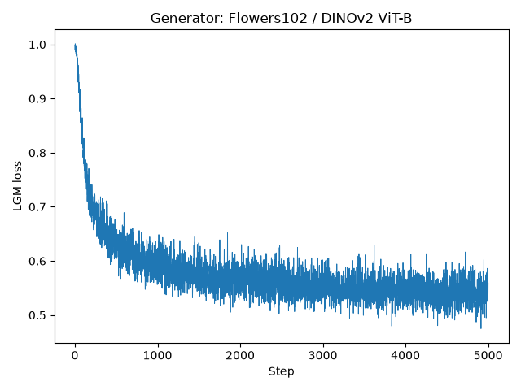
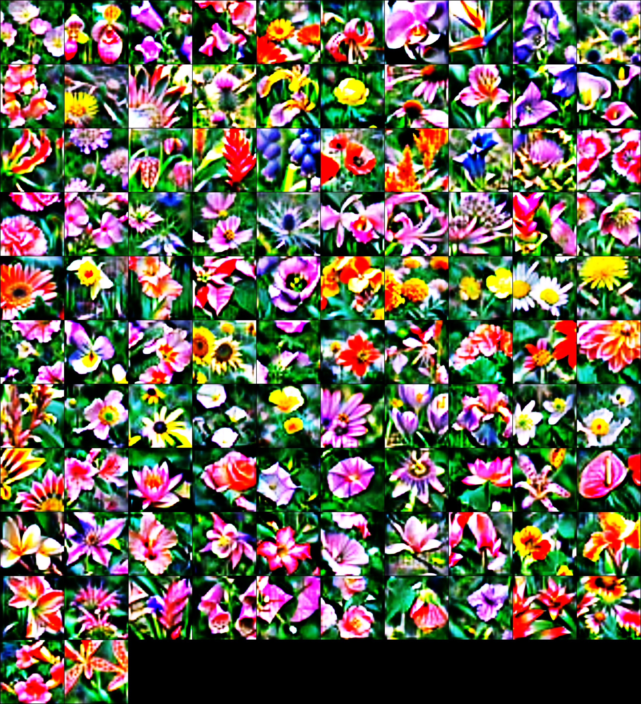

# LGM Generator: Flowers102 / DINOv2 ViT-B / IPC1 / 5000 iterations

状態: success。分類精度の評価は未実施。

## 実験条件

| 項目 | 設定 |
|---|---|
| Dataset / Model | flowers102 / dinov2_vitb |
| Mode / Optimizer / lr | generator_pixel / Adam / 0.002 |
| IPC / Iterations | 1 / 5000（step0〜5000、5001更新）|
| Noise / seed | 固定102×128、requires_grad=False / 3407 |
| Generator | Linear128→128×8×8、Upsample+Conv+ReLU→64×16×16→32×32×32、Conv→RGB32×32 |
| 出力変換 | bilinear補間256×256、従来と同じ色変換とsigmoid(2x) |
| syn_res / real_res / crop_res | 256 / 256 / 224 |
| workers / augs_per_batch | 2 / 1 |
| Augmentation / init | standard / noise |
| W&B | offline、既存のrun_name修正を使用 |
| 資源 | H100×1、gpu_1=1、tga-lab_otm、優先度0、時間上限2時間 |
| 変更範囲 | 合成データ表現のみ。元のLGM損失・Adam処理・評価コードは無変更 |

## 実行結果

- ジョブID: 9010498
- 終了コード: 0
- GPU認識: NVIDIA H100
- 完了更新数: 5001 / 5001
- 蒸留処理時間（初期化・最終保存検証を含む）: 1257.88 秒
- Python全体時間: 1385.13 秒
- 会計wallclock: 1416.287 秒
- GPUピーク割当: 15.652 GiB
- GPUピーク予約: 16.113 GiB

## Loss

記録数: 5001。最初: 0.998033702、最新: 0.559110463。

| Step | LGM Loss |
|---:|---:|
| 0 | 0.998033702 |
| 500 | 0.618103683 |
| 1000 | 0.591365814 |
| 1500 | 0.591715217 |
| 2000 | 0.547920942 |
| 2500 | 0.603724957 |
| 3000 | 0.541812241 |
| 3500 | 0.530396700 |
| 4000 | 0.539391994 |
| 4500 | 0.543093085 |
| 5000 | 0.559110463 |

[全Loss CSV](loss.csv)



## 固定ノイズ・Generator・保存検証

- Generatorパラメータ数: 1149891
- パラメータ更新: True
- ノイズ不変: True
- Adam step: 5001
- 最終Generatorと保存画像の一致: True
- CPUで重み・ノイズ・Adam状態を復元: True
- 最終検証: passed
- data.pth SHA256: d9518a060a50fde628c1e7d89ea58fa4b021a28eb8f837ebf159a67bcda61312

## 合成画像



サンプル:


## 保存先と復元

実験ルート: `/gs/bs/tga-lab_otm/us07824-lgm-generator-5000-vE8eQLnO`

- 既存評価互換の画像・ラベル: `/gs/bs/tga-lab_otm/us07824-lgm-generator-5000-vE8eQLnO/distillation/flowers102/dinov2_vitb/flowers102_generator_pixel_adam_it5000_ipc1/data.pth`
- Generator最終パッケージ: `generator_final.pth`（重み・固定ノイズ・ラベル・表現設定・Adam状態）
- 最終チェックポイント: `checkpoints/step_05000_final.pth`
- 500stepごとに別名保存: `checkpoints/step_00000.pth`〜`step_04500.pth`
- 100stepごとの復元用最新状態: `/gs/bs/tga-lab_otm/us07824-lgm-generator-5000-vE8eQLnO/distillation/flowers102/dinov2_vitb/flowers102_generator_pixel_adam_it5000_ipc1/ckpt.pth`
- チェックポイントはstep・Python/NumPy/CPU/CUDA乱数状態も保持する。
- 元実装は保存stepを再開時に再実行する。厳密な継続では保存step+1からの再開が必要。自動再開・再投入は行わない。
- PNG: `images/class_000.png`〜`class_101.png`、`synthetic_grid.png`
- 記録: `loss.csv`、`loss_curve.png`、`status.json`、`logs/gpu.log`
- 設定・ソース固定: `experiment/plan.json`、`experiment/source-manifest.json`

## エラー・警告

実行エラー記録なし。終了確認前は成功判定しない。

```text
/gs/bs/tga-lab_otm/us07824-lgm-pixel-rEKz7ETv/env/lib/python3.11/site-packages/outdated/__init__.py:36: UserWarning: pkg_resources is deprecated as an API. See https://setuptools.pypa.io/en/latest/pkg_resources.html. The pkg_resources package is slated for removal as early as 2025-11-30. Refrain from using this package or pin to Setuptools<81.
/gs/bs/tga-lab_otm/us07824-lgm-pixel-rEKz7ETv/env/lib/python3.11/site-packages/timm/models/layers/__init__.py:49: FutureWarning: Importing from timm.models.layers is deprecated, please import via timm.layers
wandb: WARNING `resume` will be ignored since W&B syncing is set to `offline`. Starting a new run with run id flowers102_generator_pixel_adam_it5000_ipc1.
/gs/bs/tga-lab_otm/us07824-lgm-pixel-rEKz7ETv/cache/torch/hub/facebookresearch_dinov2_main/dinov2/layers/swiglu_ffn.py:45: UserWarning: xFormers is disabled (SwiGLU)
/gs/bs/tga-lab_otm/us07824-lgm-pixel-rEKz7ETv/cache/torch/hub/facebookresearch_dinov2_main/dinov2/layers/swiglu_ffn.py:51: UserWarning: xFormers is not available (SwiGLU)
/gs/bs/tga-lab_otm/us07824-lgm-pixel-rEKz7ETv/cache/torch/hub/facebookresearch_dinov2_main/dinov2/layers/attention.py:29: UserWarning: xFormers is disabled (Attention)
/gs/bs/tga-lab_otm/us07824-lgm-pixel-rEKz7ETv/cache/torch/hub/facebookresearch_dinov2_main/dinov2/layers/attention.py:33: UserWarning: xFormers is not available (Attention)
/gs/bs/tga-lab_otm/us07824-lgm-pixel-rEKz7ETv/cache/torch/hub/facebookresearch_dinov2_main/dinov2/layers/block.py:35: UserWarning: xFormers is disabled (Block)
/gs/bs/tga-lab_otm/us07824-lgm-pixel-rEKz7ETv/cache/torch/hub/facebookresearch_dinov2_main/dinov2/layers/block.py:40: UserWarning: xFormers is not available (Block)
Distilling Images:   0%|          | 0/5001 [00:00<?, ?it/s]/gs/bs/tga-lab_otm/us07824-lgm-generator-5000-vE8eQLnO/src/distillation/linear_gm.py:199: FutureWarning: `torch.cuda.amp.autocast(args...)` is deprecated. Please use `torch.amp.autocast('cuda', args...)` instead.
/gs/bs/tga-lab_otm/us07824-lgm-generator-5000-vE8eQLnO/src/distillation/linear_gm.py:237: FutureWarning: `torch.cuda.amp.autocast(args...)` is deprecated. Please use `torch.amp.autocast('cuda', args...)` instead.
```

## 見積もりと会計

実行前推定30〜60分、GPU割当16〜24GiB。GeneratorのGPU実測がないためPixel実測約22分を参考にした見積もり。
時間上限2時間。30〜60分なら約0.11〜0.18ポイント、上限まで動いた場合0.32ポイント。
`0.2 × (0.7 × max(実行秒,300) + 0.1 × 7200) / 3600`（小数第5位以下切り捨て）。
[公式課金規則](https://www.somuka.titech.ac.jp/reiki_int/reiki_honbun/x385RG00001693.html)。ストレージ課金は含まない。
会計wallclockからの計算値: 0.0950ポイント（請求確定値ではない）。

## 後のPixel比較

分類精度の評価は未実施。今回の承認は蒸留1本のみ。
Pixelと同じsplit・DINOv2重み・IPC・iterations・lr・解像度・augmentationを記録する。
評価を承認された場合は元のdistillation.evalで1000epochs・3回・seed3407/3408/3409、ddof=0を揃える。
Generatorには32×32の表現制約と全画像でのパラメータ共有がある。
既存Pixelの実験結果は変更しない。

## CPU再生成と再現性の記録

CPU復元後に再生成した画像とGPU保存画像の最大絶対差: 0.007019848。
重み・固定ノイズは同一ハッシュで復元した。学習終了時のGPU上でのGenerator出力とdata.pthの一致チェックは成功している。
CPU/GPU間の再生成をビット単位で一致するとは扱わない。公式評価には今回保存した同じdata.pthを使用する。
元のチェックポイントにはDataLoaderの位置は含まれず、途中再開での完全なミニバッチ順序の再現は保証しない。

ソース基準commit: `d0dbe18683ea2f0bccda7807ca9f61c73908bced`。変更内容を含む全ソースは実験ルートsrc/に固定し、ハッシュをexperiment/source-manifest.jsonに保存した。
