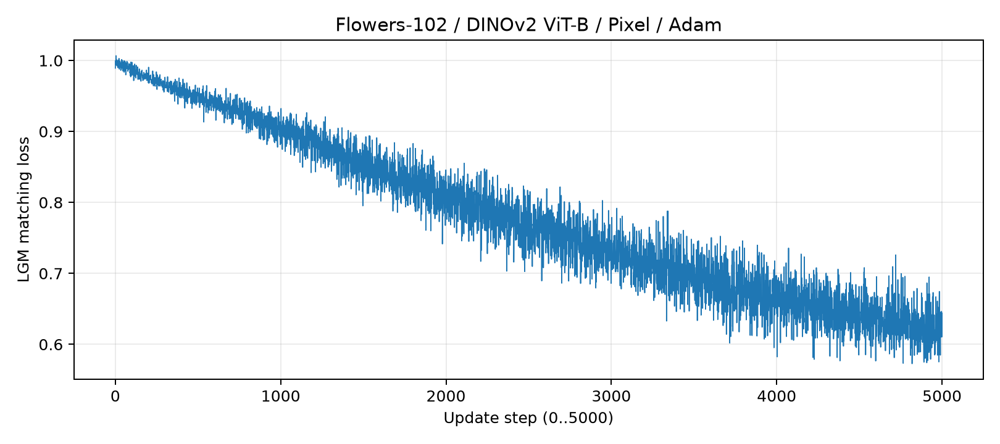
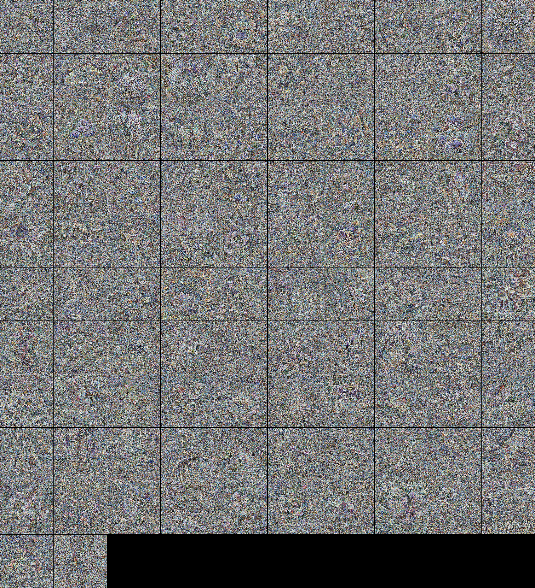
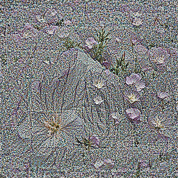
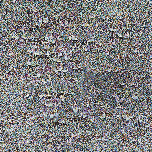
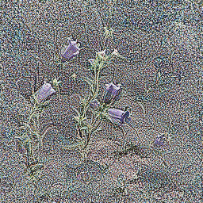
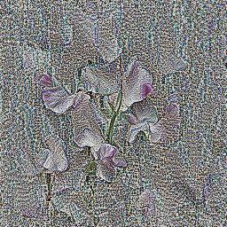
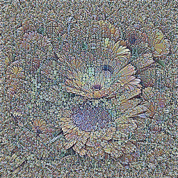
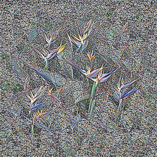
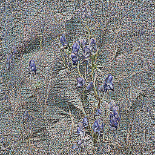
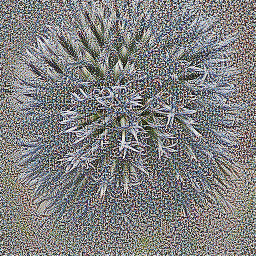

# LGM PixelDataset: Flowers-102 / DINOv2 ViT-B

蒸留: 完了。評価: 取得失敗。
GPUジョブの投入はユーザー承認後。数値は生成済みの実測ファイルのみから集計する。

## 実験条件

| 項目 | 設定 |
|---|---|
| Dataset | flowers102: train 1,020枚、test 6,149枚 |
| Model / evaluation model | dinov2_vitb / dinov2_vitb（dinov2_vitb14、特徴768次元） |
| Method | 従来のPixelDataset、Generatorなし |
| IPC / synthetic images | 1 / 102 |
| Iterations | 5000（元実装のstep 0〜5000、5,001更新） |
| Optimizer / learning rate | Adam / 0.002（元の実装を維持） |
| Distillation seed | 3407 |
| workers / augs_per_batch | 2 / 1（前回の成功条件を維持） |
| synthetic / real / crop resolution | 256 / 256 / 224 |
| Init / augmentation / color | noise / standard / decorrelate_color=True |
| Hardware | TSUBAME 4.0 H100 × 1、gpu_1=1、CPU8コア、RAM96GB |
| Group / priority / W&B | tga-lab_otm / 0 / offline |
| Time limit | 蒸留02:00:00、評価01:00:00 |
| Source commit | 33d004b8c16d9ab8e39aec780f9edad767f6f033 |
| Source patches | distill_optのCLI宣言、W&B name指定とフォールバック、lr: float型注釈 |
| Numeric routines | 元の損失関数・Adam・PixelDataset・公式Evaluatorを維持 |
| Attention backend | 前回同様xFormers無効、PyTorch math attention（二階微分対応） |

## 蒸留学習

- ジョブID: 9006325
- 完了更新数: 5001
- 蒸留処理時間（初期化・保存を含む）: 1327.34 秒
- Python全体時間: 1452.84 秒
- GPUピークメモリ: 15.806 GiB（PyTorch割当）
- Adam更新数の検証: 5001

- ジョブ終了コード: 0
- 会計記録wallclock: 1497.445 秒
- ジョブ開始〜終了: 1485.741 秒

Loss記録数: 5001。最初: 0.989191294、最後: 0.644027710。



[全ステップのLoss CSV](loss.csv)

## 合成画像



| Label | クラス名 | PNG |
|---:|---|---|
| 0 | pink primrose | [PNG](images/class_000.png) |
| 1 | hard-leaved pocket orchid | [PNG](images/class_001.png) |
| 2 | canterbury bells | [PNG](images/class_002.png) |
| 3 | sweet pea | [PNG](images/class_003.png) |
| 4 | english marigold | [PNG](images/class_004.png) |
| 5 | tiger lily | [PNG](images/class_005.png) |
| 6 | moon orchid | [PNG](images/class_006.png) |
| 7 | bird of paradise | [PNG](images/class_007.png) |
| 8 | monkshood | [PNG](images/class_008.png) |
| 9 | globe thistle | [PNG](images/class_009.png) |
| 10 | snapdragon | [PNG](images/class_010.png) |
| 11 | colt's foot | [PNG](images/class_011.png) |
| 12 | king protea | [PNG](images/class_012.png) |
| 13 | spear thistle | [PNG](images/class_013.png) |
| 14 | yellow iris | [PNG](images/class_014.png) |
| 15 | globe-flower | [PNG](images/class_015.png) |
| 16 | purple coneflower | [PNG](images/class_016.png) |
| 17 | peruvian lily | [PNG](images/class_017.png) |
| 18 | balloon flower | [PNG](images/class_018.png) |
| 19 | giant white arum lily | [PNG](images/class_019.png) |
| 20 | fire lily | [PNG](images/class_020.png) |
| 21 | pincushion flower | [PNG](images/class_021.png) |
| 22 | fritillary | [PNG](images/class_022.png) |
| 23 | red ginger | [PNG](images/class_023.png) |
| 24 | grape hyacinth | [PNG](images/class_024.png) |
| 25 | corn poppy | [PNG](images/class_025.png) |
| 26 | prince of wales feathers | [PNG](images/class_026.png) |
| 27 | stemless gentian | [PNG](images/class_027.png) |
| 28 | artichoke | [PNG](images/class_028.png) |
| 29 | sweet william | [PNG](images/class_029.png) |
| 30 | carnation | [PNG](images/class_030.png) |
| 31 | garden phlox | [PNG](images/class_031.png) |
| 32 | love in the mist | [PNG](images/class_032.png) |
| 33 | mexican aster | [PNG](images/class_033.png) |
| 34 | alpine sea holly | [PNG](images/class_034.png) |
| 35 | ruby-lipped cattleya | [PNG](images/class_035.png) |
| 36 | cape flower | [PNG](images/class_036.png) |
| 37 | great masterwort | [PNG](images/class_037.png) |
| 38 | siam tulip | [PNG](images/class_038.png) |
| 39 | lenten rose | [PNG](images/class_039.png) |
| 40 | barbeton daisy | [PNG](images/class_040.png) |
| 41 | daffodil | [PNG](images/class_041.png) |
| 42 | sword lily | [PNG](images/class_042.png) |
| 43 | poinsettia | [PNG](images/class_043.png) |
| 44 | bolero deep blue | [PNG](images/class_044.png) |
| 45 | wallflower | [PNG](images/class_045.png) |
| 46 | marigold | [PNG](images/class_046.png) |
| 47 | buttercup | [PNG](images/class_047.png) |
| 48 | oxeye daisy | [PNG](images/class_048.png) |
| 49 | common dandelion | [PNG](images/class_049.png) |
| 50 | petunia | [PNG](images/class_050.png) |
| 51 | wild pansy | [PNG](images/class_051.png) |
| 52 | primula | [PNG](images/class_052.png) |
| 53 | sunflower | [PNG](images/class_053.png) |
| 54 | pelargonium | [PNG](images/class_054.png) |
| 55 | bishop of llandaff | [PNG](images/class_055.png) |
| 56 | gaura | [PNG](images/class_056.png) |
| 57 | geranium | [PNG](images/class_057.png) |
| 58 | orange dahlia | [PNG](images/class_058.png) |
| 59 | pink-yellow dahlia? | [PNG](images/class_059.png) |
| 60 | cautleya spicata | [PNG](images/class_060.png) |
| 61 | japanese anemone | [PNG](images/class_061.png) |
| 62 | black-eyed susan | [PNG](images/class_062.png) |
| 63 | silverbush | [PNG](images/class_063.png) |
| 64 | californian poppy | [PNG](images/class_064.png) |
| 65 | osteospermum | [PNG](images/class_065.png) |
| 66 | spring crocus | [PNG](images/class_066.png) |
| 67 | bearded iris | [PNG](images/class_067.png) |
| 68 | windflower | [PNG](images/class_068.png) |
| 69 | tree poppy | [PNG](images/class_069.png) |
| 70 | gazania | [PNG](images/class_070.png) |
| 71 | azalea | [PNG](images/class_071.png) |
| 72 | water lily | [PNG](images/class_072.png) |
| 73 | rose | [PNG](images/class_073.png) |
| 74 | thorn apple | [PNG](images/class_074.png) |
| 75 | morning glory | [PNG](images/class_075.png) |
| 76 | passion flower | [PNG](images/class_076.png) |
| 77 | lotus | [PNG](images/class_077.png) |
| 78 | toad lily | [PNG](images/class_078.png) |
| 79 | anthurium | [PNG](images/class_079.png) |
| 80 | frangipani | [PNG](images/class_080.png) |
| 81 | clematis | [PNG](images/class_081.png) |
| 82 | hibiscus | [PNG](images/class_082.png) |
| 83 | columbine | [PNG](images/class_083.png) |
| 84 | desert-rose | [PNG](images/class_084.png) |
| 85 | tree mallow | [PNG](images/class_085.png) |
| 86 | magnolia | [PNG](images/class_086.png) |
| 87 | cyclamen | [PNG](images/class_087.png) |
| 88 | watercress | [PNG](images/class_088.png) |
| 89 | canna lily | [PNG](images/class_089.png) |
| 90 | hippeastrum | [PNG](images/class_090.png) |
| 91 | bee balm | [PNG](images/class_091.png) |
| 92 | ball moss | [PNG](images/class_092.png) |
| 93 | foxglove | [PNG](images/class_093.png) |
| 94 | bougainvillea | [PNG](images/class_094.png) |
| 95 | camellia | [PNG](images/class_095.png) |
| 96 | mallow | [PNG](images/class_096.png) |
| 97 | mexican petunia | [PNG](images/class_097.png) |
| 98 | bromelia | [PNG](images/class_098.png) |
| 99 | blanket flower | [PNG](images/class_099.png) |
| 100 | trumpet creeper | [PNG](images/class_100.png) |
| 101 | blackberry lily | [PNG](images/class_101.png) |

サンプル（先頭10クラス）:












## 公式評価方法と分類精度

`runpy.run_module("distillation.eval", run_name="__main__")` により公式エントリポイントを実行し、`--num_eval=3` を指定する。
同一data.pthのハッシュを評価前後で確認する。Evaluator.reset()が各回の分類器・Adam・CosineAnnealingLRを新規作成する。
乱数シードはtorch/random/numpyについて3407、3408、3409。最終回終了後の追加resetは学習を伴わず、4回目の評価は行わない。
各回1,000 epochs、eval_it=-1（epoch999で1回テスト）、patience=5、checkpoint_it=100。最良値の選択方法も元実装のまま。
分類器学習バッチサイズは100（102画像のため各epochに100枚と2枚の2バッチ）。学習率は0.001×100/256=0.000390625、weight_decay=0。
固定バックボーンに対し、AugBasic（水平反転・ランダムクロップ）を用いて線形分類器を学習する。
テストはFlowers-102 test 6,149枚、Resize256・CenterCrop224・正規化。Top-1/Top-5はmicro accuracy。
平均と標準偏差は公式のnumpy.mean / numpy.stdに合わせ、ddof=0（母標準偏差）。以下は百分率。

| 評価 | Top-1 Accuracy | Top-5 Accuracy |
|---|---:|---:|
| 1回目 | 97.3004% | 99.9512% |
| 2回目 | 96.7637% | 99.8536% |
| 3回目 | 97.3654% | 取得失敗 |
| 平均 | 97.1432% | 取得失敗 |
| 標準偏差 | 0.2696% | 取得失敗 |

評価計算3回は完了したが最終保存が失敗。Top-1の3回分は実測ログから復元した。
3回目のTop-5は取得失敗のため、Top-5の3回平均・標準偏差は算出していない。
初期チェックポイントから、シード3407/3408/3409、異なる初期重み、各回の空のAdam状態を確認済み。
詳細: `evaluation-recovered.json`。再学習・再評価・追加ジョブは行っていない。


- 評価ジョブID: 9006786
- 評価終了コード: 1
- 評価会計記録wallclock: 437.974 秒

- 評価全体時間: 413.10 秒
- 評価GPUピークメモリ: 2.046 GiB（PyTorch割当）
- 同一画像のハッシュ: 05d7bc5a4af8b87f09b503527ce722a6a9152d8e8d08419ae4e2dc5b03749653

## エラー・警告

評価: 取得失敗 — `main.<locals>.recording_save() missing 1 required positional argument: 'file'`

評価の保存失敗原因:

保存ラッパーrecording_save(obj, file, ...)がtorch.save(obj=..., f=...)のfキーワードを受け取れず、3回の評価計算後の最終保存でTypeError。
私が追加した記録ラッパーの引数名の不一致であり、公式Evaluatorの学習・精度計算は3回とも完了していた。
公式集計ファイルdinov2_vitb.pthは生成されていない。「Results saved to」は保存前のprintであり、保存成功を示さない。

警告（ログから抽出）:

```text
/gs/bs/tga-lab_otm/us07824-lgm-pixel-rEKz7ETv/env/lib/python3.11/site-packages/outdated/__init__.py:36: UserWarning: pkg_resources is deprecated as an API. See https://setuptools.pypa.io/en/latest/pkg_resources.html. The pkg_resources package is slated for removal as early as 2025-11-30. Refrain from using this package or pin to Setuptools<81.
/gs/bs/tga-lab_otm/us07824-lgm-pixel-rEKz7ETv/env/lib/python3.11/site-packages/timm/models/layers/__init__.py:49: FutureWarning: Importing from timm.models.layers is deprecated, please import via timm.layers
  warnings.warn(f"Importing from {__name__} is deprecated, please import via timm.layers", FutureWarning)
wandb: WARNING `resume` will be ignored since W&B syncing is set to `offline`. Starting a new run with run id flowers102_pixel_adam_it5000_ipc1.
/gs/bs/tga-lab_otm/us07824-lgm-pixel-rEKz7ETv/cache/torch/hub/facebookresearch_dinov2_main/dinov2/layers/swiglu_ffn.py:45: UserWarning: xFormers is disabled (SwiGLU)
/gs/bs/tga-lab_otm/us07824-lgm-pixel-rEKz7ETv/cache/torch/hub/facebookresearch_dinov2_main/dinov2/layers/swiglu_ffn.py:51: UserWarning: xFormers is not available (SwiGLU)
/gs/bs/tga-lab_otm/us07824-lgm-pixel-rEKz7ETv/cache/torch/hub/facebookresearch_dinov2_main/dinov2/layers/attention.py:29: UserWarning: xFormers is disabled (Attention)
/gs/bs/tga-lab_otm/us07824-lgm-pixel-rEKz7ETv/cache/torch/hub/facebookresearch_dinov2_main/dinov2/layers/attention.py:33: UserWarning: xFormers is not available (Attention)
/gs/bs/tga-lab_otm/us07824-lgm-pixel-rEKz7ETv/cache/torch/hub/facebookresearch_dinov2_main/dinov2/layers/block.py:35: UserWarning: xFormers is disabled (Block)
/gs/bs/tga-lab_otm/us07824-lgm-pixel-rEKz7ETv/cache/torch/hub/facebookresearch_dinov2_main/dinov2/layers/block.py:40: UserWarning: xFormers is not available (Block)
Distilling Images:   0%|          | 0/5001 [00:00<?, ?it/s]/gs/bs/tga-lab_otm/us07824-lgm-pixel-5000-lrfix-qNrXBJZ2/repo/src/distillation/linear_gm.py:199: FutureWarning: `torch.cuda.amp.autocast(args...)` is deprecated. Please use `torch.amp.autocast('cuda', args...)` instead.
/gs/bs/tga-lab_otm/us07824-lgm-pixel-5000-lrfix-qNrXBJZ2/repo/src/distillation/linear_gm.py:237: FutureWarning: `torch.cuda.amp.autocast(args...)` is deprecated. Please use `torch.amp.autocast('cuda', args...)` instead.
/gs/bs/tga-lab_otm/us07824-lgm-pixel-5000-lrfix-qNrXBJZ2/repo/src/distillation/eval.py:98: FutureWarning: `torch.cuda.amp.GradScaler(args...)` is deprecated. Please use `torch.amp.GradScaler('cuda', args...)` instead.
Epoch Progress:   0%|          | 0/2 [00:00<?, ?it/s]/gs/bs/tga-lab_otm/us07824-lgm-pixel-5000-lrfix-qNrXBJZ2/repo/src/distillation/eval.py:148: FutureWarning: `torch.cuda.amp.autocast(args...)` is deprecated. Please use `torch.amp.autocast('cuda', args...)` instead.
```

エラー行:

```text
Traceback (most recent call last):
TypeError: main.<locals>.recording_save() missing 1 required positional argument: 'file'
EVAL_STATUS {"status": "error", "completed_evaluations": [{"evaluation": 1, "seed": 3407, "top1": 0.9730037450790405, "top5": 0.9995121359825134}, {"evaluation": 2, "seed": 3408, "top1": 0.9676370024681091, "top5": 0.9985363483428955}], "config": {"dataset": "flowers102", "model": "dinov2_vitb", "eval_model": "dinov2_vitb", "num_eval": 3, "eval_epochs": 1000, "eval_it": -1, "patience": 5, "checkpoint_it": 100, "num_workers": 2, "real_batch_size": 100, "real_res": 256, "crop_res": 224, "train_crop_mode": "random"}, "data_path": "/gs/bs/tga-lab_otm/us07824-lgm-pixel-5000-lrfix-qNrXBJZ2/distillation/flowers102/dinov2_vitb/flowers102_pixel_adam_it5000_ipc1/data.pth", "data_sha256": "05d7bc5a4af8b87f09b503527ce722a6a9152d8e8d08419ae4e2dc5b03749653", "std_ddof": 0, "job_id": "9006786", "host": "r21n7", "gpu": "NVIDIA H100", "torch": "2.8.0+cu126", "cuda_build": "12.6", "source_commit": "33d004b8c16d9ab8e39aec780f9edad767f6f033", "current_evaluation": 3, "current_epoch": 900, "error": "main.<locals>.recording_save() missing 1 required positional argument: 'file'", "traceback": "Traceback (most recent call last):\n  File \"/gs/bs/tga-lab_otm/us07824-lgm-pixel-5000-lrfix-qNrXBJZ2/experiment/run_eval.py\", line 57, in main\n    namespace = runpy.run_module('distillation.eval', run_name='__main__')\n                ^^^^^^^^^^^^^^^^^^^^^^^^^^^^^^^^^^^^^^^^^^^^^^^^^^^^^^^^^^\n  File \"<frozen runpy>\", line 229, in run_module\n  File \"<frozen runpy>\", line 88, in _run_code\n  File \"/gs/bs/tga-lab_otm/us07824-lgm-pixel-5000-lrfix-qNrXBJZ2/repo/src/distillation/eval.py\", line 354, in <module>\n    torch.save(obj=save_dict, f=save_file)\nTypeError: main.<locals>.recording_save() missing 1 required positional argument: 'file'\n", "total_seconds": 413.097396583762, "peak_gpu_memory_bytes": 2197092352, "peak_reserved_gpu_memory_bytes": 2734686208}
```

## 保存先

実験ルート: `/gs/bs/tga-lab_otm/us07824-lgm-pixel-5000-lrfix-qNrXBJZ2`

- 最終合成画像: `/gs/bs/tga-lab_otm/us07824-lgm-pixel-5000-lrfix-qNrXBJZ2/distillation/flowers102/dinov2_vitb/flowers102_pixel_adam_it5000_ipc1/data.pth`（未生成の場合は未実施）
- 画像PNG: `images/class_000.png`〜`class_101.png`、`synthetic_grid.png`
- Loss: `loss.csv`、`loss_curve.png`
- 中間チェックポイント: `checkpoints/step_00000.pth`、`step_00500.pth`…`step_04500.pth`
- 最終チェックポイント: `checkpoints/step_05000_final.pth`
- 同一実験内の最新チェックポイント: `/gs/bs/tga-lab_otm/us07824-lgm-pixel-5000-lrfix-qNrXBJZ2/distillation/flowers102/dinov2_vitb/flowers102_pixel_adam_it5000_ipc1/ckpt.pth`（元実装どおり100stepごと更新）
- 公式評価の集計: `/gs/bs/tga-lab_otm/us07824-lgm-pixel-5000-lrfix-qNrXBJZ2/distillation/flowers102/dinov2_vitb/flowers102_pixel_adam_it5000_ipc1/eval/dinov2_vitb.pth`
- 評価中間状態: `evaluation-checkpoints/`（元実装が終了時に削除する最新ファイルとは別に保持）
- 記録: `distill_status.json`、`eval_status.json`、`logs/`、`experiment/plan.json`、`experiment/source-manifest.json`
- 実行環境の固定記録: `environment-lock.txt`、既存データとモデル重みを再利用
- ジョブ会計記録・終了コード: `job-accounting.json`、`logs/qacct-distill.txt`（未取得なら未実施）
- 取得失敗時の原因: `failure-diagnosis.json`（存在する場合）
- 評価会計記録: `eval-accounting.json`、`logs/qacct-eval.txt`（未取得なら未実施）
- 最終画像・Adam更新数・PNG102枚・Loss5001行の検証: passed
- 最終保存ファイルの検証記録: `distillation-validation.json`

## 承認対象の実行コマンド

```bash
cd /gs/bs/tga-lab_otm/us07824-lgm-pixel-5000-lrfix-qNrXBJZ2
qsub -g tga-lab_otm distill_job.sh
# 蒸留の正常終了とdata.pthの検証後にのみ、承認済みなら以下を実行
qsub -g tga-lab_otm eval_job.sh
```

実際の蒸留CLI（記録用ラッパーが同じ引数でmainを呼び出す）:

```bash
python -m distillation.distill --dataset=flowers102 --model=dinov2_vitb --distill_mode=pixel --distill_opt=adam --iterations=5000 --ipc=1 --lr=0.002 --num_workers=2 --augs_per_batch=1 --checkpoint_it=100 --image_log_it=500 --syn_res=256 --real_res=256 --crop_res=224 --init_mode=noise --aug_mode=standard --decorrelate_color=True --train_crop_mode=random --data_root=/gs/bs/tga-lab_otm/us07824-lgm-pixel-rEKz7ETv/data --job_tag=/gs/bs/tga-lab_otm/us07824-lgm-pixel-5000-lrfix-qNrXBJZ2/distillation --run_name=flowers102_pixel_adam_it5000_ipc1 --skip_if_exists=False
```

公式評価CLI（ラッパーが同じ引数で公式モジュールを実行する）:

```bash
python -m distillation.eval --dataset=flowers102 --model=dinov2_vitb --eval_model=dinov2_vitb --num_eval=3 --eval_epochs=1000 --eval_it=-1 --patience=5 --checkpoint_it=100 --num_workers=2 --real_batch_size=100 --real_res=256 --crop_res=224 --train_crop_mode=random --data_root=/gs/bs/tga-lab_otm/us07824-lgm-pixel-rEKz7ETv/data --job_tag=/gs/bs/tga-lab_otm/us07824-lgm-pixel-5000-lrfix-qNrXBJZ2/distillation --skip_if_exists=True
```

## 実行前の見積もり（実測結果ではない）

蒸留20〜60分・GPU割当16〜24 GiB、評価3回合計15〜45分・GPU割当4〜16 GiBを仮見積もり。
4ステップの短い実測からの外挿のため不確実。15分上限は本実験に不足する可能性が高く、蒸留2時間・評価1時間を提案。
gpu_1=1・優先度0のポイント: 蒸留約0.0867〜0.1800、評価約0.0550〜0.1250、合計約0.1417〜0.3050。
各ジョブが指定上限まで動いた場合は蒸留0.32、評価0.16、合計0.48ポイント。
式: 0.2 × (0.7 × max(実行秒,300) + 0.1 × 指定秒) / 3600。
https://www.t4.cii.isct.ac.jp/en/node/281

## Generator方式との比較に残す条件

同じFlowers-102 split、同じDINOv2重み、IPC1・102画像、画像解像度、augmentation、評価1000epochsと同じ3シード・ddofを使用する。
前回の4ステップは動作確認であり本実験精度には含めない。今回の5000iterationsが十分な収束・精度を保証するとは扱わない。
Generator方式へ変更した項目・パラメータ数・蒸留時間・GPUメモリ・全Loss履歴を別途記録し、表現方式以外の差を明示する。
