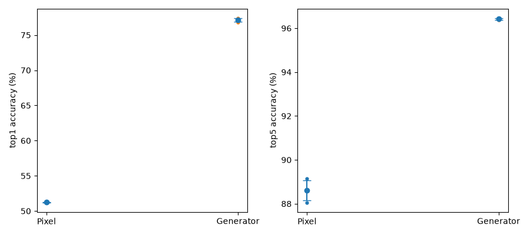
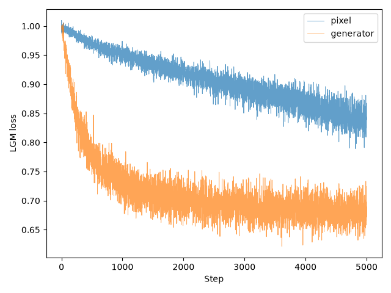
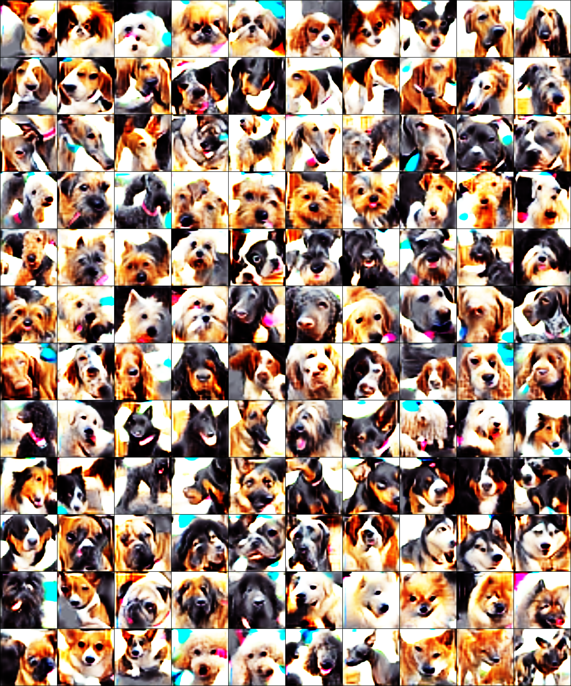
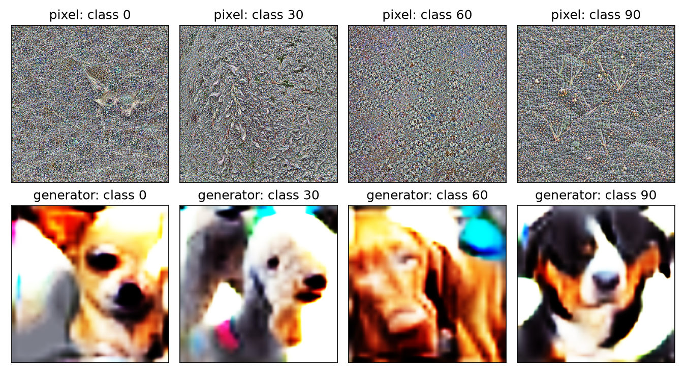

# Stanford Dogs: Pixel vs Generator

状態: complete

Stanford Dogs公式train12,000/test8,580、120クラス。DINOv2 ViT-B、IPC1、Adam lr0.002、蒸留seed3407、iterations5000（5001更新）、workers2、augs_per_batch1。
H100×1、gpu_1=1、優先度0、tga-lab_otm、W&B offline。syn/real256、crop224、standard augmentation、noise初期化、色変換True。
全画像を使用しbbox切り出しなし。ImageNet mean/std。評価は公式distillation.eval、1000epochs×3、seed3407/3408/3409、各回で新規linear head・Adam・scheduler。
評価用Adam lrは公式式を維持。各方式1蒸留の比較であり、評価3回は独立な蒸留3回ではない。

## ジョブ・時間・メモリ

| 方式 | 処理 | Job ID | exit / failed | 処理秒 | 会計秒 | GPU peak GiB | 独立検証 |
|---|---|---|---|---:|---:|---:|---|
| pixel | distill | 9013760 | 0 / 0 | 1274.864 | 1457.994 | 18.437 | passed |
| pixel | eval | 9013854 | 0 / 0 | 456.236 | 484.473 | 2.074 | passed |
| generator | distill | 9013956 | 0 / 0 | 1271.409 | 1448.492 | 18.256 | passed |
| generator | eval | 9014227 | 0 / 0 | 440.307 | 463.705 | 2.074 | passed |

取得済みqacctからのポイント推定合計: 0.2697。全4本の最大0.96ポイント（ストレージを除く）。

## 分類精度

| 方式 | 評価seed | Top-1 | Top-5 |
|---|---:|---:|---:|
| pixel | 3407 | 51.2587% | 88.0420% |
| pixel | 3408 | 51.1655% | 89.1492% |
| pixel | 3409 | 51.2587% | 88.6247% |
| pixel | 平均 | 51.2277% | 88.6053% |
| pixel | 標準偏差 ddof=0 | 0.0440 pt | 0.4522 pt |
| generator | 3407 | 77.4126% | 96.4569% |
| generator | 3408 | 76.8065% | 96.4452% |
| generator | 3409 | 77.1445% | 96.3636% |
| generator | 平均 | 77.1212% | 96.4219% |
| generator | 標準偏差 ddof=0 | 0.2480 pt | 0.0415 pt |

Generator−Pixel: Top-1 +25.8935ポイント、Top-5 +7.8166ポイント。





## 保存結果

### pixel

更新数: 5001。初回Loss: 0.9965617060661316。最終Loss: 0.8419828414916992。
data.pth: `/gs/bs/tga-lab_otm/us07824-lgm-stanford-dogs-comparison-plan-q361seki/pixel/distill/distillation/stanforddogs/dinov2_vitb/stanforddogs_pixel_adam_it5000_ipc1_s3407/data.pth`。SHA256: `f893c1fdfe0214e6cbc9cb0c51390582aafb54861cd7678017143024e49f8359`。
画像: `pixel/distill/images/`（120枚）。checkpoint: `pixel/distill/checkpoints/`（11個）。CSV: `pixel/distill/loss.csv`。


### generator

更新数: 5001。初回Loss: 1.0006963014602661。最終Loss: 0.6891002058982849。
data.pth: `/gs/bs/tga-lab_otm/us07824-lgm-stanford-dogs-comparison-plan-q361seki/generator/distill/distillation/stanforddogs/dinov2_vitb/stanforddogs_generator_adam_it5000_ipc1_s3407/data.pth`。SHA256: `b1f59f2ee31a3779a5ed09a04c5efc11b14c34ca3963964989eea7cacb2d94e8`。
画像: `generator/distill/images/`（120枚）。checkpoint: `generator/distill/checkpoints/`（11個）。CSV: `generator/distill/loss.csv`。
Generator更新: True、固定z不変: True。重み・z・ラベル・Adam: `generator/distill/generator_final.pth`。
CPU再生成の最大画像差: 0.006768226623535156。評価は保存済みGPU data.pthを使用し、CPU再生成画像は使用しない。





## エラー・警告

`generator/distill/logs/distill.log`:
```text
/gs/bs/tga-lab_otm/us07824-lgm-pixel-rEKz7ETv/env/lib/python3.11/site-packages/outdated/__init__.py:36: UserWarning: pkg_resources is deprecated as an API. See https://setuptools.pypa.io/en/latest/pkg_resources.html. The pkg_resources package is slated for removal as early as 2025-11-30. Refrain from using this package or pin to Setuptools<81.
/gs/bs/tga-lab_otm/us07824-lgm-pixel-rEKz7ETv/env/lib/python3.11/site-packages/timm/models/layers/__init__.py:49: FutureWarning: Importing from timm.models.layers is deprecated, please import via timm.layers
wandb: WARNING `resume` will be ignored since W&B syncing is set to `offline`. Starting a new run with run id stanforddogs_generator_adam_it5000_ipc1_s3407.
/gs/bs/tga-lab_otm/us07824-lgm-pixel-rEKz7ETv/cache/torch/hub/facebookresearch_dinov2_main/dinov2/layers/swiglu_ffn.py:45: UserWarning: xFormers is disabled (SwiGLU)
/gs/bs/tga-lab_otm/us07824-lgm-pixel-rEKz7ETv/cache/torch/hub/facebookresearch_dinov2_main/dinov2/layers/swiglu_ffn.py:51: UserWarning: xFormers is not available (SwiGLU)
/gs/bs/tga-lab_otm/us07824-lgm-pixel-rEKz7ETv/cache/torch/hub/facebookresearch_dinov2_main/dinov2/layers/attention.py:29: UserWarning: xFormers is disabled (Attention)
/gs/bs/tga-lab_otm/us07824-lgm-pixel-rEKz7ETv/cache/torch/hub/facebookresearch_dinov2_main/dinov2/layers/attention.py:33: UserWarning: xFormers is not available (Attention)
/gs/bs/tga-lab_otm/us07824-lgm-pixel-rEKz7ETv/cache/torch/hub/facebookresearch_dinov2_main/dinov2/layers/block.py:35: UserWarning: xFormers is disabled (Block)
/gs/bs/tga-lab_otm/us07824-lgm-pixel-rEKz7ETv/cache/torch/hub/facebookresearch_dinov2_main/dinov2/layers/block.py:40: UserWarning: xFormers is not available (Block)
Distilling Images:   0%|          | 0/5001 [00:00<?, ?it/s]/gs/bs/tga-lab_otm/us07824-lgm-stanford-dogs-comparison-plan-q361seki/generator/distill/src/distillation/linear_gm.py:199: FutureWarning: `torch.cuda.amp.autocast(args...)` is deprecated. Please use `torch.amp.autocast('cuda', args...)` instead.
/gs/bs/tga-lab_otm/us07824-lgm-stanford-dogs-comparison-plan-q361seki/generator/distill/src/distillation/linear_gm.py:237: FutureWarning: `torch.cuda.amp.autocast(args...)` is deprecated. Please use `torch.amp.autocast('cuda', args...)` instead.
```
`generator/distill/logs/independent-validation.log`:
```text
/gs/bs/tga-lab_otm/us07824-lgm-pixel-rEKz7ETv/env/lib/python3.11/site-packages/outdated/__init__.py:36: UserWarning: pkg_resources is deprecated as an API. See https://setuptools.pypa.io/en/latest/pkg_resources.html. The pkg_resources package is slated for removal as early as 2025-11-30. Refrain from using this package or pin to Setuptools<81.
```
`generator/eval/logs/eval.log`:
```text
/gs/bs/tga-lab_otm/us07824-lgm-pixel-rEKz7ETv/env/lib/python3.11/site-packages/outdated/__init__.py:36: UserWarning: pkg_resources is deprecated as an API. See https://setuptools.pypa.io/en/latest/pkg_resources.html. The pkg_resources package is slated for removal as early as 2025-11-30. Refrain from using this package or pin to Setuptools<81.
/gs/bs/tga-lab_otm/us07824-lgm-pixel-rEKz7ETv/env/lib/python3.11/site-packages/timm/models/layers/__init__.py:49: FutureWarning: Importing from timm.models.layers is deprecated, please import via timm.layers
/gs/bs/tga-lab_otm/us07824-lgm-pixel-rEKz7ETv/cache/torch/hub/facebookresearch_dinov2_main/dinov2/layers/swiglu_ffn.py:45: UserWarning: xFormers is disabled (SwiGLU)
/gs/bs/tga-lab_otm/us07824-lgm-pixel-rEKz7ETv/cache/torch/hub/facebookresearch_dinov2_main/dinov2/layers/swiglu_ffn.py:51: UserWarning: xFormers is not available (SwiGLU)
/gs/bs/tga-lab_otm/us07824-lgm-pixel-rEKz7ETv/cache/torch/hub/facebookresearch_dinov2_main/dinov2/layers/attention.py:29: UserWarning: xFormers is disabled (Attention)
/gs/bs/tga-lab_otm/us07824-lgm-pixel-rEKz7ETv/cache/torch/hub/facebookresearch_dinov2_main/dinov2/layers/attention.py:33: UserWarning: xFormers is not available (Attention)
/gs/bs/tga-lab_otm/us07824-lgm-pixel-rEKz7ETv/cache/torch/hub/facebookresearch_dinov2_main/dinov2/layers/block.py:35: UserWarning: xFormers is disabled (Block)
/gs/bs/tga-lab_otm/us07824-lgm-pixel-rEKz7ETv/cache/torch/hub/facebookresearch_dinov2_main/dinov2/layers/block.py:40: UserWarning: xFormers is not available (Block)
/gs/bs/tga-lab_otm/us07824-lgm-stanford-dogs-comparison-plan-q361seki/generator/eval/src/distillation/eval.py:98: FutureWarning: `torch.cuda.amp.GradScaler(args...)` is deprecated. Please use `torch.amp.GradScaler('cuda', args...)` instead.
Epoch Progress:   0%|          | 0/2 [00:00<?, ?it/s]/gs/bs/tga-lab_otm/us07824-lgm-stanford-dogs-comparison-plan-q361seki/generator/eval/src/distillation/eval.py:148: FutureWarning: `torch.cuda.amp.autocast(args...)` is deprecated. Please use `torch.amp.autocast('cuda', args...)` instead.
```
`pixel/distill/logs/distill.log`:
```text
/gs/bs/tga-lab_otm/us07824-lgm-pixel-rEKz7ETv/env/lib/python3.11/site-packages/outdated/__init__.py:36: UserWarning: pkg_resources is deprecated as an API. See https://setuptools.pypa.io/en/latest/pkg_resources.html. The pkg_resources package is slated for removal as early as 2025-11-30. Refrain from using this package or pin to Setuptools<81.
/gs/bs/tga-lab_otm/us07824-lgm-pixel-rEKz7ETv/env/lib/python3.11/site-packages/timm/models/layers/__init__.py:49: FutureWarning: Importing from timm.models.layers is deprecated, please import via timm.layers
wandb: WARNING `resume` will be ignored since W&B syncing is set to `offline`. Starting a new run with run id stanforddogs_pixel_adam_it5000_ipc1_s3407.
/gs/bs/tga-lab_otm/us07824-lgm-pixel-rEKz7ETv/cache/torch/hub/facebookresearch_dinov2_main/dinov2/layers/swiglu_ffn.py:45: UserWarning: xFormers is disabled (SwiGLU)
/gs/bs/tga-lab_otm/us07824-lgm-pixel-rEKz7ETv/cache/torch/hub/facebookresearch_dinov2_main/dinov2/layers/swiglu_ffn.py:51: UserWarning: xFormers is not available (SwiGLU)
/gs/bs/tga-lab_otm/us07824-lgm-pixel-rEKz7ETv/cache/torch/hub/facebookresearch_dinov2_main/dinov2/layers/attention.py:29: UserWarning: xFormers is disabled (Attention)
/gs/bs/tga-lab_otm/us07824-lgm-pixel-rEKz7ETv/cache/torch/hub/facebookresearch_dinov2_main/dinov2/layers/attention.py:33: UserWarning: xFormers is not available (Attention)
/gs/bs/tga-lab_otm/us07824-lgm-pixel-rEKz7ETv/cache/torch/hub/facebookresearch_dinov2_main/dinov2/layers/block.py:35: UserWarning: xFormers is disabled (Block)
/gs/bs/tga-lab_otm/us07824-lgm-pixel-rEKz7ETv/cache/torch/hub/facebookresearch_dinov2_main/dinov2/layers/block.py:40: UserWarning: xFormers is not available (Block)
Distilling Images:   0%|          | 0/5001 [00:00<?, ?it/s]/gs/bs/tga-lab_otm/us07824-lgm-stanford-dogs-comparison-plan-q361seki/pixel/distill/src/distillation/linear_gm.py:199: FutureWarning: `torch.cuda.amp.autocast(args...)` is deprecated. Please use `torch.amp.autocast('cuda', args...)` instead.
/gs/bs/tga-lab_otm/us07824-lgm-stanford-dogs-comparison-plan-q361seki/pixel/distill/src/distillation/linear_gm.py:237: FutureWarning: `torch.cuda.amp.autocast(args...)` is deprecated. Please use `torch.amp.autocast('cuda', args...)` instead.
```
`pixel/distill/logs/independent-validation.log`:
```text
/gs/bs/tga-lab_otm/us07824-lgm-pixel-rEKz7ETv/env/lib/python3.11/site-packages/outdated/__init__.py:36: UserWarning: pkg_resources is deprecated as an API. See https://setuptools.pypa.io/en/latest/pkg_resources.html. The pkg_resources package is slated for removal as early as 2025-11-30. Refrain from using this package or pin to Setuptools<81.
```
`pixel/eval/logs/eval.log`:
```text
/gs/bs/tga-lab_otm/us07824-lgm-pixel-rEKz7ETv/env/lib/python3.11/site-packages/outdated/__init__.py:36: UserWarning: pkg_resources is deprecated as an API. See https://setuptools.pypa.io/en/latest/pkg_resources.html. The pkg_resources package is slated for removal as early as 2025-11-30. Refrain from using this package or pin to Setuptools<81.
/gs/bs/tga-lab_otm/us07824-lgm-pixel-rEKz7ETv/env/lib/python3.11/site-packages/timm/models/layers/__init__.py:49: FutureWarning: Importing from timm.models.layers is deprecated, please import via timm.layers
/gs/bs/tga-lab_otm/us07824-lgm-pixel-rEKz7ETv/cache/torch/hub/facebookresearch_dinov2_main/dinov2/layers/swiglu_ffn.py:45: UserWarning: xFormers is disabled (SwiGLU)
/gs/bs/tga-lab_otm/us07824-lgm-pixel-rEKz7ETv/cache/torch/hub/facebookresearch_dinov2_main/dinov2/layers/swiglu_ffn.py:51: UserWarning: xFormers is not available (SwiGLU)
/gs/bs/tga-lab_otm/us07824-lgm-pixel-rEKz7ETv/cache/torch/hub/facebookresearch_dinov2_main/dinov2/layers/attention.py:29: UserWarning: xFormers is disabled (Attention)
/gs/bs/tga-lab_otm/us07824-lgm-pixel-rEKz7ETv/cache/torch/hub/facebookresearch_dinov2_main/dinov2/layers/attention.py:33: UserWarning: xFormers is not available (Attention)
/gs/bs/tga-lab_otm/us07824-lgm-pixel-rEKz7ETv/cache/torch/hub/facebookresearch_dinov2_main/dinov2/layers/block.py:35: UserWarning: xFormers is disabled (Block)
/gs/bs/tga-lab_otm/us07824-lgm-pixel-rEKz7ETv/cache/torch/hub/facebookresearch_dinov2_main/dinov2/layers/block.py:40: UserWarning: xFormers is not available (Block)
/gs/bs/tga-lab_otm/us07824-lgm-stanford-dogs-comparison-plan-q361seki/pixel/eval/src/distillation/eval.py:98: FutureWarning: `torch.cuda.amp.GradScaler(args...)` is deprecated. Please use `torch.amp.GradScaler('cuda', args...)` instead.
Epoch Progress:   0%|          | 0/2 [00:00<?, ?it/s]/gs/bs/tga-lab_otm/us07824-lgm-stanford-dogs-comparison-plan-q361seki/pixel/eval/src/distillation/eval.py:148: FutureWarning: `torch.cuda.amp.autocast(args...)` is deprecated. Please use `torch.amp.autocast('cuda', args...)` instead.
```

実行状態・エラー: `execution-status.json`。データ監査: `data-validation.json`。公式取得SHA256: `download-manifest.json`。
既存Flowers出力は保存先に指定せず、保護対象のSHA256を実行・独立検証で照合する。取得できていない精度や実測値は未実施と記載する。
